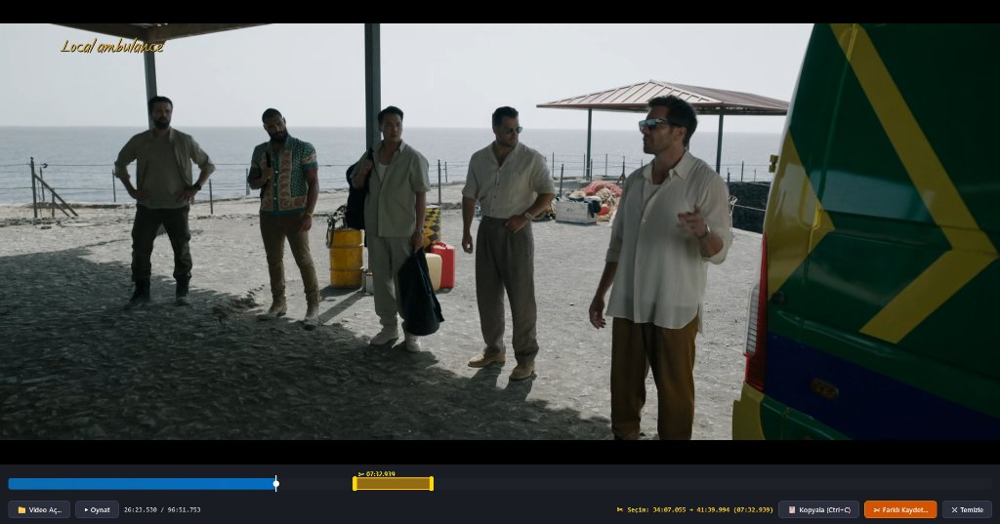

# 🎬 Smart Video Trimmer (Drag & Paste)

<p align="center">
  <a href="#-features">Features</a> •
  <a href="#-download--run-portable-exe">Download</a> •
  <a href="#-shortcuts--usage">Usage</a> •
  <a href="#-run-from-source">Developers</a> •
  <a href="#-türkçe-özet">Türkçe Özet</a>
</p>

Smart Video Trimmer is a **lightweight, lossless, and ultra-fast** Windows desktop application designed for video creators and anyone needing instant video trimming.

Instead of re-encoding and waiting for minutes, it cuts video clips **in 1 second without quality loss** using **FFmpeg Stream Copy** technology.

---



---

## 🌟 Features

- 🖱️ **Drag-to-Folder (Direct Export):**  
  Select a clip on the timeline and simply drag the yellow range directly onto Windows Explorer or your Desktop. The clip is saved instantly into that folder!
- 📋 **Clipboard Copy & Paste (Ctrl+C / Ctrl+V):**  
  Select a clip, press `Ctrl+C`, navigate to any folder in Windows, and press `Ctrl+V`. Your cut video file is right there!
- ⚡ **Lossless & Lightning Fast:**  
  Zero re-encoding (`-c copy`). Even 4K / 60fps clips are trimmed in seconds while retaining 100% of the original video and audio quality.
- 🎯 **Effortless Loading:**  
  Drag and drop any video file directly into the application window.
- ⏱️ **Millisecond Precision Timeline:**  
  Interactive seekbar with draggable start/end handles and smooth hover preview lines.
- 🌐 **Bilingual (EN / TR):**  
  Toggle between English and Turkish with a single click using the flag button (🇬🇧 / 🇹🇷).

---

## 📥 Download & Run (Portable .EXE)

No Python or dependencies required:

1. Go to the [Releases](https://github.com/mehmedzen/video-trimmer/releases) page.
2. Download **`SmartVideoTrimmer.exe`**.
3. Double-click and start trimming!

---

## 🎮 Shortcuts & Usage

| Action | How to |
|---|---|
| **Open Video** | Drag & drop video onto the window, or press `Ctrl + O` |
| **Play / Pause** | `Spacebar` |
| **Select Clip Range** | **Hold Right-Click and drag** on the timeline (or `Shift + Left-Click`) |
| **Adjust Range** | Drag the yellow handles on the start/end points |
| **Copy to Clipboard** | `Ctrl + C` (then `Ctrl + V` in any Explorer folder) |
| **Drag-Out to Save** | Click & drag the yellow selection bar directly into Desktop/Folder |
| **Save As** | Click `✂ Save As...` button |
| **Switch Language** | Click the flag icon (🇬🇧 / 🇹🇷) at the bottom right |

---

## 🛠️ Run from Source (Developers)

If you'd like to run from source code or contribute:

### Prerequisites
- Python 3.10+
- [FFmpeg](https://ffmpeg.org/download.html) (must be in system PATH)

### Quick Start
```bash
# 1. Clone the repository
git clone https://github.com/mehmedzen/video-trimmer.git
cd video-trimmer

# 2. Install dependencies
pip install -r requirements.txt

# 3. Launch the app
python app.py
```
*(On Windows, you can also double-click `run.bat`)*

---

<details>
<summary><b>🇹🇷 Türkçe Özet</b></summary>

### 🎬 Akıllı Video Kırpıcı (Sürükle & Yapıştır)

Smart Video Trimmer, video içerik üreticileri için tasarlanmış kayıpsız ve ultra hızlı bir Windows video kesme aracıdır.

- **Klasöre Sürükle-Bırak:** Timeline'da seçtiğin sarı alanı tutup doğrudan masaüstüne veya bir klasöre sürükleyerek kaydedebilirsin.
- **Kopyala / Yapıştır (Ctrl+C / Ctrl+V):** Seçili aralığı kopyalayıp herhangi bir klasörde `Ctrl+V` ile anında oluşturabilirsin.
- **Kayıpsız & Hızlı:** FFmpeg stream copy (`-c copy`) ile yeniden kodlamadan 1 saniyede keser.
- **Dil Seçeneği:** Sağ alttaki bayrak butonu ile Türkçe ve İngilizce arasında tek tıkla geçiş yapabilirsin.

Detaylar için [Releases](https://github.com/mehmedzen/video-trimmer/releases) sekmesinden kurulumsuz `.exe` dosyasını indirebilirsin.
</details>

---

## 📄 License
This project is licensed under the [MIT](LICENSE) License.
